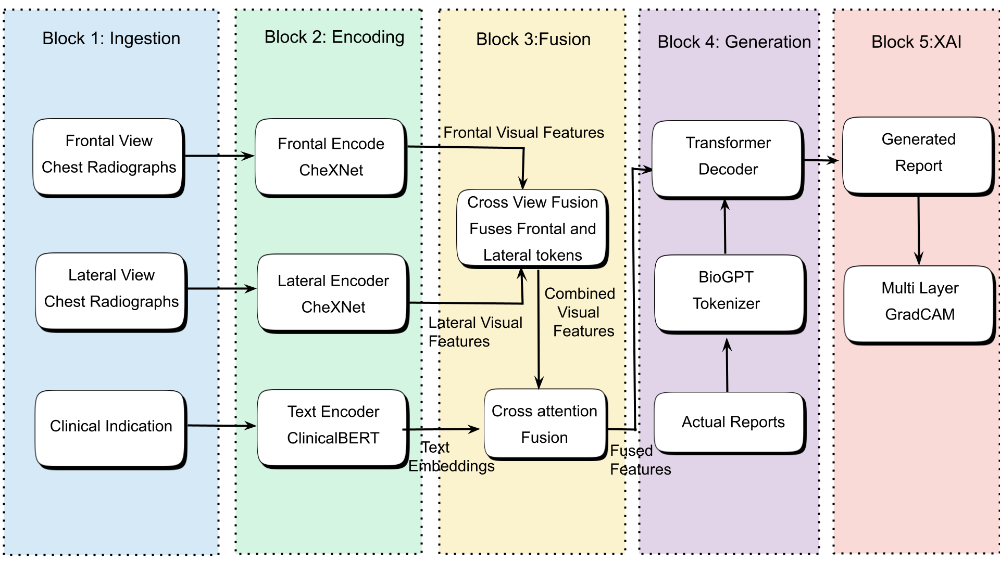
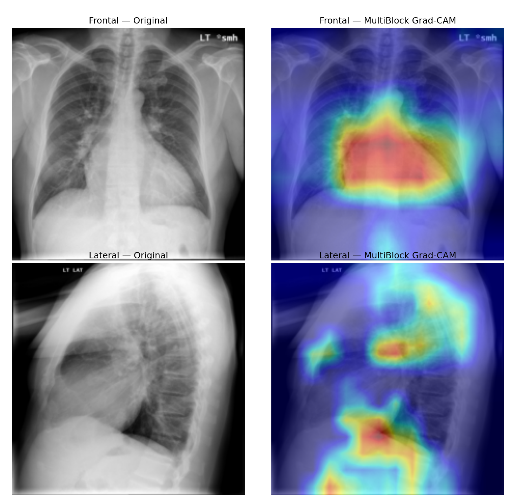

# Multimodal Framework for Automated Chest X-Ray Report Generation with Explainable AI

> **Note on Publication Status:**  
> This repository is an engineering showcase for a research manuscript currently in preparation for peer review. To protect novelty prior to publication, the core model architecture, training implementation, and trained checkpoint weights are held in a private repository and will be released upon publication. Recruiters and hiring managers may request access to the full codebase.

---

## Overview

Automated Radiology Report Generation (ARRG) systems draft preliminary clinical findings from chest radiographs to assist radiologists and reduce reporting backlogs. 

Most existing ARRG pipelines condition only on a single radiograph and offer no visual verification for the generated text. This project addresses three practical clinical gaps in a unified framework:
1. **Multi-View Processing:** Incorporates both Frontal (PA/AP) and Lateral chest radiographs rather than relying on a single projection.
2. **Clinical Context Conditioning:** Integrates the referring clinician's free-text clinical indication (symptoms and clinical history) alongside visual features.
3. **Report-Level Explainable AI (XAI):** Generates Grad-CAM saliency heatmaps per view to highlight the anatomical regions supporting the generated report.

---

## System Overview

<!-- Upload your high-level block diagram to assets/architecture_diagram.png -->

  
   
  <em>Figure 1: High-level pipeline from multi-view radiographs and clinical indication to report generation and visual explanation.</em>

### Technical Stack
* **Visual Backbone:** Pretrained DenseNet-121 (CheXNet) feature extractors for processing frontal and lateral projections.
* **Clinical Text Encoder:** Pretrained Bio-ClinicalBERT (`emilyalsentzer/Bio_ClinicalBERT`) for encoding patient indications.
* **Multimodal Fusion & Decoding:** Transformer-based cross-modal fusion and autoregressive report decoding using the BioGPT (`microsoft/biogpt`) biomedical vocabulary.
* **Explainability:** Gradient-based saliency mapping producing per-view visual explanations aligned with the generated clinical findings.

---

## Quantitative Summary

The model is evaluated on a 80:10:10 split (`2,795` complete studies: `2,239` train, `281` validation, `275` test) of the **Indiana University Chest X-Ray (IU X-Ray)** dataset, retaining studies that contain both frontal and lateral projections, a clinical indication, and a findings report.

### Test Set Performance

| Metric | Score |
| :--- | :---: |
| **BLEU-1** | 0.4857 |
| **BLEU-4** | 0.2417 |
| **ROUGE-L** | 0.3760 |
| **METEOR** | 0.1845 |

In our ablation experiments, removing the clinical indication input reduces test **BLEU-4 from 0.2417 to 0.1516**, demonstrating that clinical context provides signal that the radiographs alone do not capture. Full comparative benchmarks and ablation tables are detailed in the manuscript.

---

## Qualitative Results & Visual Explanations

<!-- Upload your Grad-CAM figure (Fig. 2 from the paper) to assets/gradcam_examples.png -->

  
   
  <em>Figure 2: Frontal and lateral saliency maps on unseen test studies (UIDs 2208, 1642, and 1432).</em>

### Sample Predictions

| Study UID | Ground Truth Findings | Generated Findings |
| :---: | :--- | :--- |
| **2208** | *persistent cardiomegaly. no abnormal airspace consolidation. resolved interstitial edema. no pneumothorax or pleural effusion.* | *heart size mildly enlarged, stable mediastinal and hilar contours, mediastinal calcifications suggest a previous granulomatous process. no focal alveolar consolidation, no definite pleural effusion seen. no typical findings of pulmonary edema.* |
| **768** | *normal heart size and mediastinal contours. no focal air space opacities. no pleural effusion. visualized osseous structures are unremarkable.* | *no focal areas of consolidation. no suspicious pulmonary opacities. heart size within normal limits. no pleural effusions. no evidence of pneumothorax. osseous structures intact.* |

---

## Included Utilities & Scripts

While the core training pipeline is private during peer review, this repository includes the standalone data preparation, encoder diagnostic, and evaluation scripts used in the project:

* `data_preprocessing/build_multiview_dataset.py` — Pairs Frontal and Lateral projections per study (`uid`) from the IU X-Ray metadata CSVs, cleans de-identification placeholders (`XXXX`), filters incomplete records, and generates the train/validation/test splits.
* `data_preprocessing/filter_report_length.py` — Tokenizes findings with `BioGptTokenizer` and filters records exceeding the content-token budget so boundary tokens (`<bos>`, `<eos>`) are preserved without truncation.
* `evaluation/metrics.py` — Corpus-level evaluation module computing NLTK BLEU-1/BLEU-4 (with Chen & Cherry Method-1 smoothing), Porter-stemmed ROUGE-L, and `pycocoevalcap` METEOR.

---

## Authors & Contact

* **Rajni Bala** — Department of Computer Science, Deen Dayal Upadhyaya College, University of Delhi
* **Divyanshu Yadav** *(Corresponding Author)* — Department of Computer Science, Deen Dayal Upadhyaya College, University of Delhi ([divyanshu1006s@gmail.com](mailto:divyanshu1006s@gmail.com))
* **Ram Pal Singh** — Department of Computer Science, Deen Dayal Upadhyaya College, University of Delhi
* **Ankita Dagar** — Independent Researcher, Delhi, India

---

## License

Copyright © 2026 Divyanshu Yadav. All rights reserved.

No part of this repository may be reproduced, distributed, or used to train or publish derivative models without prior written permission from the authors. Experiments use the publicly available, de-identified Indiana University Chest X-Ray (IU X-Ray) dataset *(Demner-Fushman et al., 2016)*.
